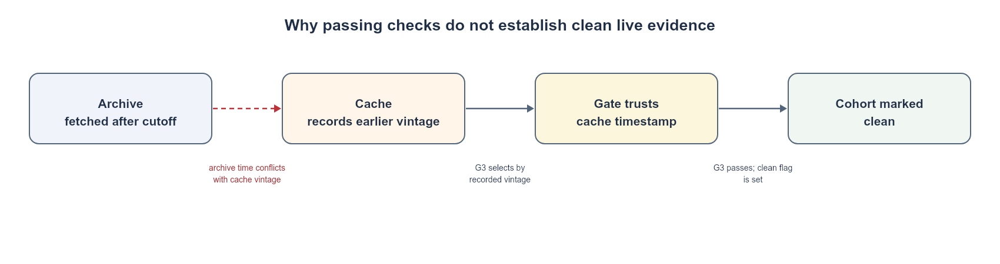

# Quantitative loop report: validation and red-team review

> Do not accept the supplied report as evidence that predictions are improving. Much of its arithmetic reproduces, but the published cohort has inconsistent price-capture timestamps, and the improvement narrative confuses retrospective legacy results with a V2 challenger that has not learned yet.

Reviewed on 2026-10-19. This review examines the supplied “Quantitative Loop Execution & Prediction Improvement Report,” the current working tree, both state and legacy databases, the price cache, retained capture archives, persisted gates, and the normative specification. All source-database connections used by this review were read-only. Existing source, database, and UI changes were preserved.

The [evidence snapshot](quant_loop_report_redteam_2026-10-19_evidence.json) contains exact SQL, results, source hashes, recomputed statistics, and verifier outcomes. Local values are verified facts about the retained artifacts; they are not independent certification of vendor market prices. Suggested remedies below have not been applied.

## 1. Critical: the published cohort's price provenance fails the cutoff contract

Take one closing price in the September cohort. Its source archive says it was fetched in October. Its cache row says it was already observed at the September cutoff. The price selector trusts the cache timestamp, so the row becomes eligible for a prediction it should not support.

| Evidence | Value |
|---|---|
| Cohort | `live:2026-09-30` |
| Knowledge cutoff: latest admissible observation time | `2026-09-30T18:29:59.999999Z` |
| Actual source fetch, in archive metadata and state capture registry | `2026-10-17T18:19:38.773804Z` |
| Stored observation time for rows from that source | `2026-09-30T18:29:59.999999Z` |
| Affected rows / securities | `6,200 / 500` |
| September month-end closes from that source | `500`, all available month-end closes |
| Publication time | `2026-10-17T18:26:37.448458Z` |

The source identifier is `cap_prices_3cfc595b5984bfd7`. Its decompressed archive SHA256 matches its metadata and registry hash. The timestamp conflict is therefore attached to the same captured bytes, not an accidental comparison of unrelated downloads. The earlier retained price capture ends in mid-September and cannot supply the missing month-end closes.

The persisted run sequence corroborates the failure: the first monthly attempt was blocked because no completed month-end closes existed at the required vintage; a later attempt published. With actual archive fetch times enforced, the retained evidence contains no admissible September month-end closes and the price prerequisite remains blocked.

**Fact:** source fetch time and cached observation time disagree. **Inference:** the later source rows were backdated or otherwise written with an earlier timestamp. The artifacts do not establish who did this or why. This is a provenance failure even if every price value is numerically accurate.

The normative [clock contract](../spec/MASTER_SPEC.md#21-clock-contract) prohibits backdating. [Price acquisition](../../quant/data/prices.py#L324) copies the actual fetch time to `observed_at`; [price selection](../../quant/data/prices.py#L406) filters that field without cross-checking the capture registry. The existing [PIT verifier](../../quant/verify.py#L196) checks publication ordering, factor cutoff strings, fundamentals, holdings, attributes, and label ordering, but does not reconcile price-row timestamps against source capture timestamps. Its checks all pass on this contradictory dataset.



[Editable diagram source](quant_loop_report_redteam_2026-10-19_diagram.mmd).

**Fix:** preserve the evidence and record an explicit invalidation/exclusion of this cohort from clean-live training and performance summaries. Rebuild a separate cache from retained archives using actual fetch times. Add a blocking consistency check joining every selected price vintage to its capture ID, source hash, and actual observation time. Do not rewrite immutable published history to conceal the incident. A retrospective reconstruction can be retained on a clearly separate track.

## 2. High: there is no demonstrated V2 learning

The report's evaluated models are `LEGACY_V18` and `LEGACY_V18_BASE`. The newly published models are `EW_HIER_v1` and `IC_SHRUNK_v1`. These are different systems with different weighting policies.

| Stored fact | Observed state |
|---|---|
| Legacy cohorts | `4`, all marked `is_clean=0` |
| Cohorts tagged live | `1`; its clean designation is disputed above |
| Matured live label rows | `0` |
| V2 challenger family weights | `2,000 / 10,000` units in each of `5` families |
| Challenger effective evidence count, `n_eff` | `0` |
| Challenger learning strength, `alpha` | `0` |
| Challenger learning gate | `closed`, evidence hash `empty_history` |
| Champion versus challenger scores/ranks | Identical across the joined cohort rows |

This is the intended equal-weight fallback, not evidence of successful adaptation. The [weighting specification](../spec/MASTER_SPEC.md#63-shrunk-family-weights) requires clean live evidence. Neither legacy factor performance nor a newly created live ranking establishes that V2 has learned.

**Fix:** replace the affirmative improvement verdict with “V2 learning and predictive improvement are unproven; its challenger remains at equal weights.” Keep legacy retrospective results in a separately labelled section. Evaluate future stored predictions prospectively after fixing provenance.

## 3. High: the baseline comparison does not isolate learned weights

Both legacy model variants receive the same weight vector for each model version. [Migration](../../quant/migrate/legacy.py#L403) copies the same weights into both variants. One variant uses the original final score; the other uses the pre-multiplier composite. The source database has no populated `base_score` values, so [migration reconstructs the base](../../quant/migrate/legacy.py#L518).

| Claim in supplied report | What the comparison actually measures |
|---|---|
| Optimized weights versus unoptimized weights | Final legacy score versus reconstructed pre-multiplier score, with the same weights |
| Genuine positive alpha from weight learning | A difference in rank correlation; neither causal attribution nor net portfolio alpha |
| Consistently better across cohorts | The final model performs worse in the first reported short-horizon cohort |
| End-state weights explain the evaluated periods | The quoted endpoint weights belong to a later September version |

| Cohort / horizon | Final IC | Base IC | Final minus base |
|---|---:|---:|---:|
| June / next-month endpoint | -0.068746 | -0.022241 | -0.046505 |
| July / next-month endpoint | +0.097278 | +0.029101 | +0.068177 |
| August / next-month endpoint | +0.070956 | +0.016188 | +0.054768 |
| Mean across those short-horizon cohorts | +0.033163 | +0.007683 | +0.025480 |
| June / third-month endpoint | +0.082414 | +0.029647 | +0.052767 |

The evaluated June, July, and August score batches use versions `6`, `9`, and `10`. The advertised final growth, valuation, and smart-money weights belong to version `12`, effective in September. Those later weights cannot explain scores already frozen in earlier cohorts. The legacy series also mixes changing model versions, so it is an operational strategy series rather than a fixed-model experiment.

**Fix:** rename the comparison accurately. To isolate learning, register a future comparison with fixed initial weights versus learned weights, keeping features, multipliers, eligibility, labels, execution, and costs identical. Freeze both arms before outcomes arrive. Do not retrofit that experiment into historical live records.

## 4. High: reproducible statistics do not support the strength of the conclusion

Rank IC here means Spearman correlation between model score and **sector-relative log total return**: a security's log return minus its frozen sector group's median log return. It is not correlation with raw arithmetic return, nor a portfolio return measured in basis points.

| Cohort | Stored horizon | Actual endpoint | Elapsed days | Finite pairs | Final IC | Recomputed nominal p-value |
|---|---:|---|---:|---:|---:|---:|
| 2026-06-12 | 1M | 2026-07-31 | 49 | 498 | -0.068746 | 0.125500 |
| 2026-07-10 | 1M | 2026-08-31 | 52 | 498 | +0.097278 | 0.029966 |
| 2026-08-14 | 1M | 2026-09-30 | 47 | 497 | +0.070956 | 0.114139 |
| 2026-06-12 | 3M | 2026-09-30 | 110 | 496 | +0.082414 | 0.066664 |

The headline ICs reproduce to the supplied precision. Some p-values differ slightly: the August result rounds to `0.114`, not `0.113`; the July base result rounds to `0.517`, not `0.516`. These small differences do not drive the verdict.

The calendar-month endpoints are specified behavior for migrated cohorts, but “one month” is not a literal monthly holding period here. The adjacent holding windows overlap. The short-horizon observations and June's longer-horizon observation are not independent evidence of strengthening signals.

The reported smart-money HAC t-statistic also reproduces. HAC is an estimator intended to account for serial dependence; in this calculation the lag parameter is zero, so no positive-lag dependence is included.

```text
Input short-horizon ICs = 0.0611084493, 0.0484024736, 0.0524030412
Number of observations = 3
HAC lag                = 0
Computed t-statistic   = 17.623288
```

The large ratio comes from low observed variation among a tiny set of historical observations. It is not proof of future consistency, causal learning, or a robust estimate across market regimes. A nominal cross-sectional significance result similarly does not establish temporal improvement. Selecting the positive month after examining multiple models, factors, and horizons introduces multiple-testing and selection bias: repeated searches create more opportunities for an apparently significant result.

The project's [statistics and promotion rules](../spec/MASTER_SPEC.md#73-statistics) require explicit sample counts, dependence treatment, registered comparisons, and maturity gates. The cited factor result is not eligible evidence for promotion. [SciPy's primary documentation](https://docs.scipy.org/doc/scipy/reference/generated/scipy.stats.spearmanr.html) also cautions that its asymptotic Spearman p-values are accurate only for very large samples and suggests permutation methods for smaller samples. Permuting stocks without considering sector dependence would still not solve the temporal evidence problem. [Harvey, Liu, and Zhu](https://doi.org/10.1093/rfs/hhv059) explain why ordinary significance thresholds are inadequate after extensive factor testing.

**Fix:** present these results as descriptive legacy associations. Remove “proving,” “genuine alpha,” and the universal claim that a particular IC range is exceptionally strong. Define the label and holding endpoints, report the finite sample and omissions, and reserve improvement claims for a predeclared paired prospective comparison with suitable uncertainty and costs.

## 5. High: the selected winners hide the complete pick-set result

The highlighted stock returns mostly match stored arithmetic return labels. The omission is the rest of the preselected set. Recomputing every available top-ranked name reveals a materially less favorable picture.

| Legacy cohort | Top-50 names with usable labels | Mean gross return | Median gross return | Names losing money | Comparable scored-universe mean |
|---|---:|---:|---:|---:|---:|
| June | 49 / 50 | +6.1431% | +6.0826% | 19 | +4.6349% |
| July | 50 / 50 | +3.5985% | +2.9476% | 19 | +0.8978% |
| August | 50 / 50 | -6.1066% | -6.2616% | 40 | -5.0930% |

These are means of stored gross arithmetic labels, not simulated executable portfolio returns. The comparator includes scored names with finite matching labels and is not a sector-matched or risk-adjusted benchmark. The excluded June outcome is disclosed rather than silently treated as a zero. Exact query semantics and worst performers are in the evidence snapshot.

For a concrete omission, August's highest-ranked stock, SONATSOFTW, has a stored return of `-20.7579%`. A positive whole-universe IC can coexist with a disappointing top-ranked basket. Neither metric substitutes for the other.

The report's “Group Alpha” is the stored sector-relative **log** return. For Aegis, the reported short-horizon figures combine arithmetic return and log excess:

```text
Arithmetic stock return       = +36.35% (rounded)
Sector-relative log return    = +0.288449 (approximately)
```

Subtracting those displayed percentages as if they were the same return measure would be incorrect. Also, none of the showcased outcomes demonstrates a doubling; calling them multi-bagger successes overstates what was measured.

**Fix:** show the complete prespecified basket, losses, missing outcomes, sector exposure, turnover, matched benchmarks, and net costs. Rename “Group Alpha” to sector-relative log return or calculate a clearly defined arithmetic excess return. Use the long-horizon doubling metric for multi-bagger claims.

## 6. Medium: gate and operational claims need narrower wording

| Supplied claim | Verified interpretation |
|---|---|
| Latest cohort published | True as a database event; publication occurred in October, and clean provenance is invalidated by finding 1 |
| All quality gates verified | False as stated: `8 PASS`, `2 DEFERRED`; G4 and G9 were deferred |
| Leakage gate passed | Recorded PASS with `7` checks evaluated; replay, embargo, and survivorship checks were deferred |
| Latest stock ranking table | The first eight rows match; the remaining seven ranks, names, and scores do not match the stored champion or identical challenger |
| Champion and challenger picks | They coincide because the challenger is still at equal weights |
| Reconciled daily prices | Row count matches: `1,148,710` rows, `501` securities; count does not establish timestamp correctness |
| Frozen legacy database unchanged | SHA256 exactly matches the frozen reference |
| Statistical alpha / paper success | No filled trades, positions, or realized portfolio-return rows are available |

First-cohort gate deferrals are permitted by the specification. They must be disclosed; their existence alone is not evidence of a bypass. The price-source mismatch is a separate, substantive failure.

The ranking mismatch is directly reproducible from both the database and UI payload:

| Rank | Supplied report | Stored champion / UI |
|---:|---|---|
| 9 | CHAMBLFERT, 2.07 | SAGILITY, 2.085356 |
| 10 | GLENMARK, 2.06 | ATUL, 2.069902 |
| 11 | TORNTPHARM, 2.04 | KAJARIACER, 1.959964 |
| 12 | AUROPHARMA, 2.01 | AXISBANK, 1.941470 |
| 13 | COROMANDEL, 1.99 | JSWSTEEL, 1.914506 |
| 14 | CESC, 1.97 | ADANIPORTS, 1.889510 |
| 15 | FEDERALBNK, 1.96 | BPCL, 1.889510 |

For example, TORNTPHARM is actually ranked `251` with a final score of `-0.026114`. This is not rounding. The database contains the challenger and reference-model scores; the UI ranking payload displays the champion. Champion-only display is not itself evidence that challenger predictions were never generated. Regenerate the report table from pinned database rows instead of manually transcribing it.

Orders are pending, and the earliest stored execution session follows actual generation. The prediction's September as-of date is not a September execution date. The evidence snapshot records the exact generated and earliest-execution timestamps.

There is a further provenance gap in sector classifications. The cohort's mappings have October observation timestamps but a September effective date. [The selector](../../quant/sectors/taxonomy.py#L216) filters effective dates without checking observation time. These group values may be derivable entirely from a pre-cutoff universe archive and fixed rules; actual use of future classification content is not proven. Still, the recorded source chain does not enforce the contract. Retain the source capture and rule version, distinguish derivation time from knowledge time, and enforce the latter.

## 7. Medium: the exported ledger does not reproduce the current state

An additional read-only verification replayed the actual exported ledger into a temporary database and compared every state table. This is stronger evidence than the synthetic engineering recovery test.

| Table | Rebuilt from exported ledger | Current state DB |
|---|---:|---:|
| Run records | 11 | 12 |
| Data-quality events | 12 | 13 |
| Internal journal events | 147,914 | 147,917 |

The other table comparisons passed. The missing exported tail is the final maintenance run: its start record, a data-quality event, and its final status. All these writes exist in the database's internal journal. This is **stale export**, not evidence that those writes bypassed journaling. It nevertheless prevents exact recovery of the present database from the exported files.

**Fix:** export only after final run-state persistence, then verify the actual state against a temporary replay. Check the returned verification statuses, not just whether the process ran without an exception. The review did not export or change the real ledger. See [real-ledger verification log](/private/tmp/quant-report-redteam-20261019/real-ledger-verify.log).

## 8. Verification, limitations, and acceptance criteria

Fresh checks used the existing virtual-environment interpreter and repository configuration. Temporary test outputs were redirected beneath the audit's temporary directory.

| Check | Fresh result | Scope |
|---|---|---|
| Specification checker, via `./scripts/check.sh` | 10 PASS | Specification structure and frozen-source inventory |
| Full pytest, via `./scripts/check.sh` | 663 passed, 1 failed; command exit 1 | Current suite in this execution environment |
| `./scripts/signoff.sh --phase engineering` | 7 PASS, 1 FAIL; exit 1 | Failed row is the same full pytest check |
| Direct read-only `quant.verify.pit` | 6 PASS | Does not reconcile price cache observation time with source capture time |
| Archived monthly report verification | 6 PASS across 2 snapshots | Content hashes, evaluation status vocabulary, and renderer reproduction |
| State SQLite integrity check | `ok` | Database structure; not economic or temporal correctness |
| Actual exported-ledger replay versus state | 42 PASS, 3 FAIL | Stale exported tail documented in finding 7; replay output confined to a temporary DB |
| Source hashes before and after checks | Unchanged | State DB, frozen legacy DB, price DB, and existing UI exporter change |

The sole reproducible pytest failure is [the network-guard assertion](../../tests/unit/test_ws00_05.py#L12). DNS fails before the monkeypatched socket connection method runs. The test expects an exception containing “network”; it receives a DNS-error message. This is an environment-sensitive assertion mismatch, not evidence that an outbound request succeeded or that scoring regressed. The report's historical all-pass statement cannot be independently reproduced in this environment; this does not prove it never passed elsewhere. Make this guard test deterministic by controlling DNS or exercising the guarded operation directly.

Canonical logs: [full checks](/private/tmp/quant-report-redteam-20261019/check-default.log), [engineering sign-off](/private/tmp/quant-report-redteam-20261019/signoff-engineering.log), and [sign-off JSON](/private/tmp/quant-report-redteam-20261019/signoff-engineering.json). An earlier path-overridden test attempt conflicted with tests that assert canonical configuration paths and was excluded from valid product-check evidence. Its outputs remain in the same temporary directory for transparency.

The engineering ledger check uses a synthetic isolated database. The separate actual-ledger replay found the mismatches above. Its direct library invocation returned a `CheckReport` containing failures while the shell command exited successfully; this review inspected the individual results rather than treating that exit as a pass. Passing engineering tests, archived-report hash checks, or the current PIT verifier does not establish authentic source timestamps. The price provenance failure was found through an independent cross-check that the existing verifier omits.

**What would change the critical finding:** an independently retained, hash-matching capture proving these particular month-end input rows were actually acquired before the cutoff, together with a documented explanation for their current conflicting source identifiers. The retained archives inspected here do not supply that evidence. Re-downloading matching historical values now would not prove prior possession.

**What remains unknown:** who changed the cache vintage; whether individual source price values are market-correct; whether V2 will produce useful future rankings; whether an honestly evaluated learned challenger will outperform equal weights. Missing evidence is not proof that the investment thesis is false.

Recommended next action: invalidate this cohort for clean-live evidence through a recorded control decision, preserve the current artifacts, and implement the capture-consistency check before the next publication. No source correction or cohort reclassification was performed by this review.

Acceptance checks for the remediation:

- A price fetched after the cutoff remains inadmissible even if its cache timestamp is changed to the cutoff.
- A missing capture ID, source-hash mismatch, or inconsistent observation timestamp blocks clean publication.
- Rebuilding from the retained archives uses their actual timestamps and reproduces the missing-month-end prerequisite for this historical run.
- Invalidation excludes affected labels, evaluations, and weights from future clean-live training without deleting immutable history.
- Reports distinguish pass, deferred, descriptive legacy evidence, and eligible live evidence; headline claims are derived from those states.

| Current report wording | Defensible replacement |
|---|---|
| “Substantial and measurable improvement has occurred.” | “Legacy retrospective associations are mixed; V2 improvement is unproven.” |
| “Strictly preserving PIT invariants.” | “The published cohort has a price-source timestamp inconsistency and must not be counted as clean live evidence.” |
| “Weight learning generated genuine positive alpha.” | “Legacy final scores sometimes rank outcomes better than a reconstructed pre-multiplier score; the comparison does not isolate learned weights.” |

Confidence is judgment, not a calibrated statistical posterior:

```text
Confidence in the audit interpretation: 99%
Confidence that repairing provenance alone will improve prediction accuracy: unquantifiable
Confidence in a forecast of future V2 outperformance: unquantifiable from current evidence
```

Correctness, failure modes, auditability, and recovery were assessed. Deployment scaling, multitenant isolation, infrastructure cost, and tax treatment were not binding questions for validating this report and were not assessed.

```text
Authentic capture history
    -- establishes --> admissible inputs
    -- permit --> prospective predictions
    -- accumulate --> matured comparable outcomes
    -- support testing --> a learning claim
```

Leadership sentence: “The pipeline produced a ranking, but its clean-data claim failed and we do not yet have evidence that the new model learns or outperforms.”
